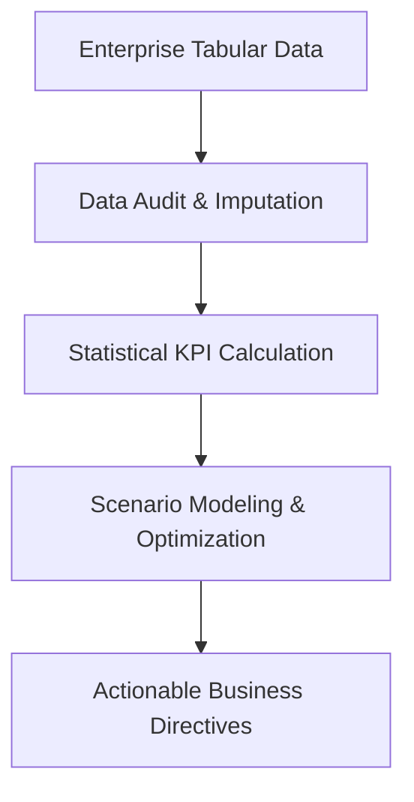

<p align="center">
  
</p>

<p align="center">
  
  
  
  
</p>

---

## Executive Summary / Overview
### Problem Statement & Context
Strategic organizational planning demands quantifiable forecasting frameworks rather than intuitive guesses. Business analytics provides mathematical and statistical structures that translate operational metrics into predictive insights, minimizing downside risks in resource allocation.

### Solution Overview
This repository serves as a dedicated quantitative workbench for advanced business analytics workflows. It houses exploratory decision models, scenario sensitivity calculators, econometric evaluations, and quantitative research notes supporting data-backed operational strategies.

---

## Interactive Table of Contents
- [Executive Summary / Overview](#executive-summary--overview)
- [Key Features & Capabilities](#key-features--capabilities)
- [System Architecture / Pipeline](#system-architecture--pipeline)
- [Tech Stack Breakdown](#tech-stack-breakdown)
- [Reproducible Quickstart & Setup](#reproducible-quickstart--setup)
- [Project Directory Layout](#project-directory-layout)
- [Author & Contributions](#author--contributions)

---

## Key Features & Capabilities
- **Predictive Decision Trees:** Mathematical modeling of branching organizational choices under risk and uncertainty.
- **Sensitivity & Variance Analysis:** Algorithmic parameter variation to quantify margin sensitivity to demand shocks.
- **Statistical Metric Benchmarking:** Standardized calculation of standard deviation, confidence intervals, and hypothesis tests for business variables.
- **Structured Analytical Architecture:** Designed for modular ingestion of tabular enterprise records and automated reporting pipelines.

---

## System Architecture / Pipeline


---

## Tech Stack Breakdown
| Layer | Technology | Purpose |
| :--- | :--- | :--- |
| **Languages** | Python 3.10+, SQL | Data aggregation and statistical computations |
| **Libraries** | NumPy, Pandas, SciPy | Matrix operations, distribution modeling, variance metrics |
| **Tools** | Jupyter Lab, Microsoft Excel / Sheets | Exploratory calculation workbenches and visualization |
| **Architecture** | Quantitative Decision Framework | Branching scenario trees and probabilistic forecasts |

---

## Reproducible Quickstart & Setup
```bash
# 1. Clone repository
git clone https://github.com/suryateja-155/Business-analytics-projects.git
cd Business-analytics-projects

# 2. Virtual environment setup
python -m venv venv
# Windows:
.\venv\Scripts\activate
# Linux/macOS:
source venv/bin/activate

# 3. Install dependencies
pip install numpy pandas scipy jupyterlab
```

---

## Project Directory Layout
```text
Business-analytics-projects/
└── README.md    # Conceptual frameworks, problem formulations, and analytical guides
```

---

## Author & Contributions

**Gettupalli Surya Teja**  
- GitHub Profile: [@suryateja-155](https://github.com/suryateja-155)  
- Portfolio Index: [Gettupalli-Surya-Teja](https://github.com/suryateja-155/Gettupalli-Surya-Teja)

Contributions, issue reports, and feedback are always welcome! Feel free to open an issue or pull request.

<p align="center">
  
</p>
